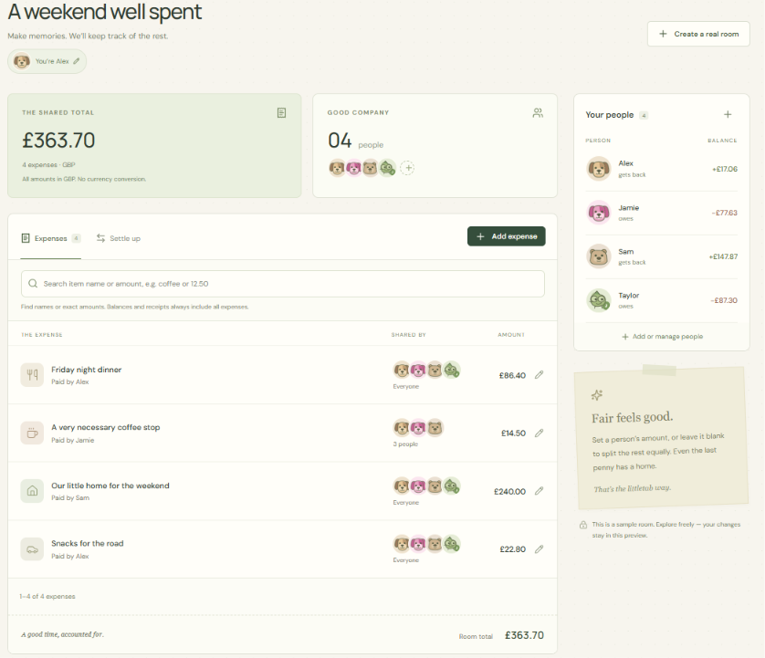
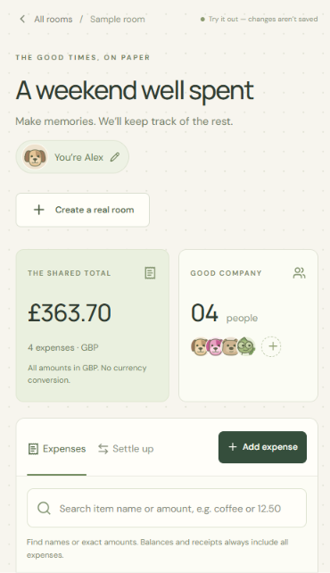
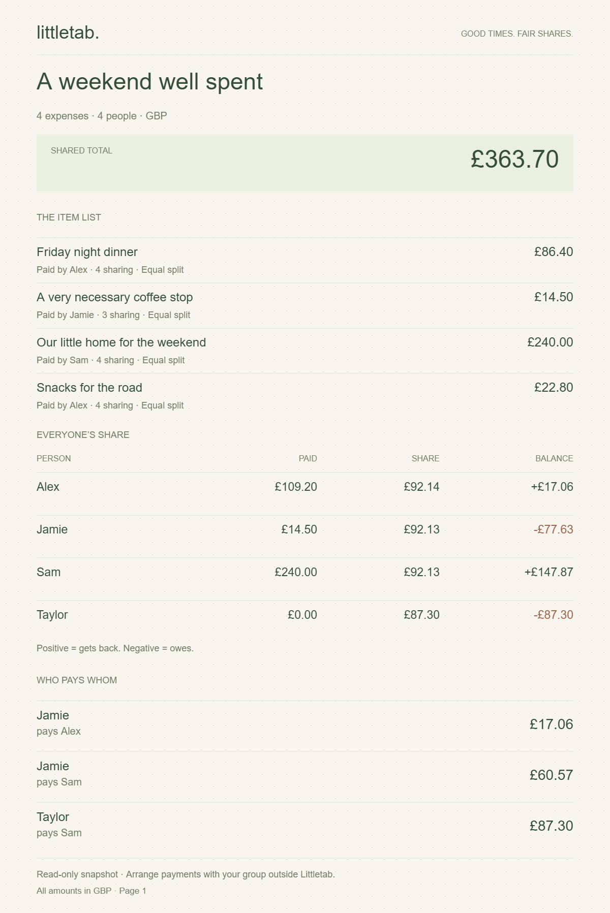

# Littletab

**Good times. Fair shares.**

An account-free expense splitter for trips, dinners, and shared moments. Create a room, invite your people, add expenses, and see who owes whom—all on a little sheet of dotted paper.

[Try the live demo](https://littletab.onrender.com) · Choose **Try a sample room** to explore without saving data.

The hosted demo currently runs the transaction-date release; the receipt animation and searchable, paginated expense table described below are available in this checkout and await deployment.

## Screenshots

Desktop expense list with colourful profiles and search:



<details>
<summary>Mobile layout and receipt preview</summary>

<p></p>

<p></p>

</details>

## What you can do

- Create a room with a five-digit code and a quick four-digit PIN; share an invite link with one click.
- Add people before they join. Guests can choose an existing name or create their own.
- Assign each expense to selected people, splitting equally or mixing custom amounts with automatic shares.
- Add expense dates, search by name or amount, and browse six transactions per page.
- See balances and suggested payments, then preview a printable receipt or download it as PNG images.
- Pick a colourful animal avatar and optionally share UK bank or PayPal payment details with your room.

Rooms expire after 30 days. The creator can delete them earlier from the browser that created them. Each room uses GBP, USD, EUR, or THB; currencies are not converted. Littletab calculates balances and does not process payments. Everyone with the room PIN can edit its shared data.

## Try it locally

Requirements: Node.js 22+ and Python 3.12+. From the project root on Windows:

```powershell
py -3 -m venv .venv
.\.venv\Scripts\python.exe -m pip install -r backend/requirements.txt
npm ci
npm ci --prefix frontend
npm run build
npm start
```

Open [localhost:8000](http://127.0.0.1:8000). Choose **Try a sample room** to explore without saving data, or create a real room.

Without `DATABASE_URL`, real rooms use local SQLite. To use PostgreSQL, set `DATABASE_URL` in a private `.env.local` file. The backend loads it; database credentials never belong in frontend code. Existing environment variables take priority.

For frontend development, run `npm run dev --prefix frontend` in a second terminal while the API runs. Vite proxies API requests to port 8000.

## Stack

React, TypeScript and Vite · FastAPI · SQLAlchemy and psycopg · PostgreSQL (Neon), with SQLite for local development.

The production Docker image builds React and serves the frontend and API together from FastAPI.

## Free demo hosting

Use **Render Free** for the app and **Neon Free** for PostgreSQL. The included `render.yaml` configures one free Docker web service with manual deployments. Follow the [deployment guide](docs/DEPLOY.md).

A hosted demo and a public source repository are separate choices: Render can deploy a private GitHub repository. Free services have usage limits, and Render may take about a minute to wake after inactivity. The demo homepage and API health endpoint have been verified.

## Checks

```powershell
npm run build
npm test
.\.venv\Scripts\python.exe -m pytest backend/tests -q
```

The API tests recreate their test tables. Never set `TEST_DATABASE_URL` to a database containing real data.

See the [development reference](docs/DEVELOPMENT.md) for detailed behaviour, [Neon setup notes](docs/NEON_SETUP.md) for database verification, and [showcase checklist](docs/SHOWCASE.md) for repository presentation.

## License

[MIT](LICENSE)
